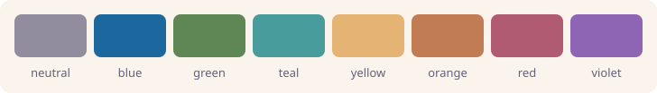

# copper-design

copper is one design system for several apps. This repository is its single source: what two or more apps share lives
here (for colours, as named colours and general roles), and a generator renders its tokens into each target's own
format. It is filled step by step: colours first, then dimensions such as corner radius and spacing, then icons and
illustrations.

<picture>
  <source media="(prefers-color-scheme: dark)" srcset="docs/swatch-dark.svg">
  <source media="(prefers-color-scheme: light)" srcset="docs/swatch-light.svg">
  
</picture>

## Consumers

A consumer is anything that takes its colours, dimensions or artwork from copper: a Home Assistant theme, Android apps
such as a calendar app and a weather app, and later terminal and self-hosted app themes. Each one pins a release of this
repository and updates by moving the pin.

## How it is built

For colours:

- **Palette**: eight base colours, each a scale of 12 steps with a fixed job per step, set in OKLCH separately for light
  and dark mode and computed from a small parameter file (`copper_design/parameters.toml`).
- **Named colours** and **roles**: each base colour's main value and its steps under their names, and a small set of
  general UI roles (backgrounds, borders, text, accent, selection, states), each pointing at a palette step per mode. A
  colour only one app uses, such as a calendar's colours, stays with that app and is picked from the named colours
  there.
- **Tokens**: palette and roles as [DTCG 2025.10](https://www.designtokens.org/) JSON, one file per mode, and a resolver
  file that selects the mode, all in `copper_design/tokens/`.
- **Ports**: a Python generator with Jinja2 templates renders the tokens into generic ports, one per target, committed
  under `ports/<target>/`:
  - `ports/herdr/`: a [herdr](https://github.com/herdrdev/herdr-app) terminal theme pair, `copper-light.json` and
    `copper-dark.json`. Beside herdr's own colour names they carry copper's named colours and roles for herdr's mods,
    under keys prefixed `copper-` (`copper-blue-3`, `copper-border`).
  - `ports/android/`: laid out as an Android source set. `kotlin/dev/cupr/design/CopperColors.kt` holds every named
    colour and role as Compose colours (`CopperColors.light.blue9`, `CopperColors.dark.bg`), and `CopperColorScheme.kt`
    the Material 3 colour schemes built from them (`CopperColorScheme.light`, `.dark`). `res/values/copper_colors.xml`
    and `res/values-night/copper_colors.xml` hold the same colours as resources (`@color/copper_bg_alt`) for what
    Android draws outside Compose, such as the window, the splash screen, widgets and the launcher icon.

An icon or illustration enters only once its provenance is checked. The terms, with the base colours and the roles by
name, are defined in [GLOSSARY.md](GLOSSARY.md), the decisions behind this layout in [docs/adr/](docs/adr/).

## Taking a port

A consumer copies a port unchanged at a pinned release tag and can check its copy byte for byte against that tag. An
Android app copies `ports/android/kotlin/` and `ports/android/res/` into its `app/src/main/`; the Kotlin needs Compose
and material3 (the scheme follows material3's `ColorScheme` as of 1.4.0). Whether its screens use copper's colour scheme
or the phone's dynamic colours stays the app's call.

## Status

The palette, the roles, the herdr port and the Android port are here. The mood follows the measured properties of Rosé
Pine (a warm, paper-like light mode, a violet-grey dark mode, dusty and muted colours), not its colours. More ports (a
Home Assistant theme) come next, each through an issue of its own.

## Development

The tasks run through [mise](https://mise.jdx.dev/), which brings Python, uv and Deno.

```sh
mise trust
mise run setup   # the locked dependencies from uv.lock into .venv
mise run lock    # rewrite uv.lock and build-constraints.txt after a dependency in pyproject.toml changed
mise run test    # the tests
mise run lint    # ruff, basedpyright, Markdown format and Markdown lint
mise run gate    # test, then lint; CLAUDE.md (Pipeline) says which CI checks it leaves out
mise run render  # the palette tokens from the parameter file, then the ports and the swatch from the tokens
python -m copper_design preview <file.html>   # a preview page of the palette, the roles and their contrast
```

## License

MIT, see [LICENSE](LICENSE).
